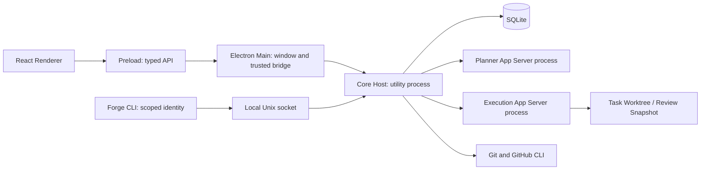

# Forge Desktop — 产品与工程规格

| 属性             | 内容                                                                                                   |
| ---------------- | ------------------------------------------------------------------------------------------------------ |
| 规格版本         | 0.3.0；独立于应用发布版本                                                                              |
| 日期             | 2026-11-25                                                                                             |
| 状态             | Proposed；可评审的目标规格，尚未实施                                                                   |
| 产品形态         | Local-first 桌面工程任务工作台                                                                         |
| 目标用户         | 个人开发者、独立使用工具的技术负责人                                                                   |
| 首版交付平台     | macOS Apple Silicon；其他平台后续验证                                                                  |
| 首个 Agent / SCM | Codex App Server / GitHub.com                                                                          |
| 代码策略         | 在 forge-lane 原仓库演进；旧 Web 服务端停止功能开发                                                    |
| 旧版归档         | 分支 `codex/legacy-web`；标签 `legacy-web-2026-11-25`；提交 `78f90b957a6c3cd820012b68aae65fe3c3b175af` |

## 1. 决策摘要与适用范围

Forge 以项目和任务为中心，帮助用户把需求转为可追踪的开发任务，并在明确授权后调用现有 Coding Agent 完成实现、测试和交付。看板是主要界面，聊天用于规划、澄清和介入执行。

已经由用户确认：保留原仓库，旧 Web 服务端留在归档分支，新版独立演进。此前提供的产品文档是需求输入，本规格结合现有实现补齐工程约束；冲突处以本规格批准后的规则为准。

本次选定的技术方案：**TypeScript + Electron + React + electron-vite + SQLite + Prisma ORM 7 + better-sqlite3**。本地 Core 运行在 Electron utility process，使用 Git CLI、GitHub CLI 和 Codex App Server 执行外部操作。

以下为本次设计默认值，不表述为用户此前已确认的要求：

- 首版仅交付 macOS Apple Silicon，避免同时承担多平台安装、沙箱和进程恢复成本。
- 新版新建本地数据库，不自动导入旧 PostgreSQL 数据；Git 分支与标签只保存旧代码，不包含旧数据库。旧 PostgreSQL 实例/备份由原部署保留，新版不得删除或迁移它们。
- 执行通道一次一个 Developer 或 Reviewer Run；规划通道另保留一个 Planner Run，最多同时两个主动 Run。允许其他任务等待 CI、人工操作或外部合并。
- 自动返工默认关闭；用户开工时可启用，最多三轮，不自动扩充预算。
- 普通用户的执行授权、权限放行和 Merge 仅通过桌面端操作；首版 CLI 作为规划与查询入口。
- 首版手动更新应用，不提供常驻 Daemon、后台自动更新或跨设备同步。

本文件定义产品行为、技术边界和验收条件，不是逐文件实施计划。技术选择以现有代码、部署成本和官方接口为依据；用户对 Prisma 和 Codex 原始会话的询问不被解释为指定 ORM 或要求客户端同步。本文变更不安装依赖、搭建工程或修改业务代码。

## 2. 目标、非目标与成功标准

### 2.1 目标

1. Task 不依赖聊天存在；没有 Agent 时仍可管理需求。
2. Planner 能把讨论结果写入任务，不能自行授权开工。
3. 用户授权一个任务后，系统能追踪到代码、PR、CI、Review 和最终合并。
4. 工作流由 Core 校验，所有写入口遵守同一规则。
5. 出错时展示真实阶段、已产生的外部结果和可执行的恢复动作。
6. 用户主要负责需求、优先级、权限与合并决策。

### 2.2 非目标

首版不包含多人组织与登录系统、Sprint、成员估点、邮件通知、远程 Web 服务、旧 API 兼容、自动旧数据导入、完整 IDE、终端模拟器、通用 Pipeline 编辑器、多 Harness、Agent Swarm、GitLab、GitHub Enterprise、Fork PR、堆叠 PR、远程执行、插件市场和自动部署。

不重新实现 Agent Runtime，不根据 Agent 的“已完成”文字直接放行交付，不把 Worktree 当成安全沙箱。不维持旧 Web 产品与桌面产品的双向同步。

### 2.3 成功指标

- 从开工到 Ready to Merge 的耗时及人工操作次数。
- 获得授权后，无人工修复完成交付的任务比例。
- 重复 Run / Worktree / PR 数量，目标为零。
- 故障后正确恢复关联、避免重复副作用的比例。
- 每任务 Agent 使用量、返工次数和人工介入原因；不可获得的费用显示未知，不编造金额。

## 3. 技术栈与方案取舍

### 3.1 选定技术栈

| 层         | 选择                                                | 理由与边界                                                                                           |
| ---------- | --------------------------------------------------- | ---------------------------------------------------------------------------------------------------- |
| 语言       | TypeScript，strict 模式                             | 复用现有前后端知识与类型体系                                                                         |
| 桌面       | Electron                                            | 复用 React UI；直接使用 Node 进程、Git、Codex 与本地文件能力                                         |
| 构建       | electron-vite                                       | 统一 main / preload / renderer 构建；Core 作为独立 Node 目标入口打包                                 |
| 安装包     | electron-builder 稳定版                             | 首版输出 arm64 DMG；签名、公证与原生模块打包纳入发布验证                                             |
| UI         | React 19、React Router、TanStack Query              | 延续现有栈；查询经 bridge 调用 Core，不保留 Cookie/HTTP 登录假设                                     |
| 交互与样式 | Radix UI、dnd-kit、Lucide、CSS / PostCSS            | 复用现有组件；不同时迁移 UI 框架或引入 Tailwind                                                      |
| Markdown   | MDXEditor + react-markdown / remark-gfm             | Markdown 为唯一存储源；禁用不可信 HTML 与可执行 MDX                                                  |
| Core       | Node.js API、普通 TypeScript 模块、显式依赖注入     | 不新建 NestJS HTTP 服务；Core 不导入 Electron，宿主适配层负责启动与通信                              |
| 本地存储   | SQLite + @prisma/adapter-better-sqlite3             | Prisma 负责业务访问；better-sqlite3 负责驱动和维护；单 Core 写入                                     |
| ORM / 迁移 | Prisma ORM 7 + Prisma Migrate 7                     | 保留客户端与事务使用方式；SQLite 使用独立 schema/迁移；随安装包分发迁移 CLI 和目标平台 schema engine |
| 输入契约   | Zod + 可序列化 DTO                                  | UI、CLI、Agent 输出和恢复事件均做运行时校验                                                          |
| 桌面通信   | 窄化 preload API + Electron IPC + MessagePort       | renderer 不接触数据库、任意命令或通用 IPC 能力                                                       |
| CLI 通信   | Unix domain socket + 版本化 JSON-RPC 2.0 / JSONL    | 本机端点，不开放 TCP；CLI 与 UI 使用同一应用服务                                                     |
| Agent      | 本地 Codex App Server，stdio JSON-RPC               | 固定兼容范围，生成对应版本协议类型，复用现有认证                                                     |
| SCM        | Git CLI + GitHub CLI                                | Core 控制 fetch / push / PR / merge；不自建 OAuth 或保存 PAT                                         |
| 日志       | Pino + 文件轮转                                     | 结构化日志、敏感字段脱敏、请求与运行关联                                                             |
| 测试       | Vitest、React Testing Library、Playwright           | 核心状态机、真实临时 Git/SQLite、renderer 交互；另有打包后 Electron 冒烟                             |
| 工具链     | PNPM Workspace、Oxlint、Oxfmt、TypeScript typecheck | 保留仓库已有质量工具                                                                                 |

版本策略：开发环境沿用 Node.js 24 和仓库固定 PNPM 版本。桌面运行时使用 Electron 自带 Node，不要求最终用户安装 Node。已有 React 等依赖在兼容时保留，新增 Electron、构建工具、SQLite adapter、better-sqlite3 使用非 prerelease 的稳定版本，M0 完成兼容测试后将确切版本与锁文件提交；不凭本文猜测补丁号，不直接复制文档中的 `@rc` 安装命令。

Prisma 以仓库现有 `7.10.0` 为验证基线，`prisma`、`@prisma/client`、`@prisma/adapter-better-sqlite3` 固定同一兼容版本；不随本次改造升级 Prisma 大版本。文档、CLI 命令和迁移格式使用 Prisma v7 对应版本，不能因官网默认文档变化混入其他大版本做法。

本地已观察到 Codex CLI `0.154.0`，它是首次兼容验证候选，不代表其他版本已通过验证。外部 Git、gh、Codex 不静默自动升级；应用显示实际版本和支持情况。

### 3.2 备选方案及结论

| 方案                                 | 收益                                        | 代价                                                           | 结论   |
| ------------------------------------ | ------------------------------------------- | -------------------------------------------------------------- | ------ |
| Electron + React + 新本地 Core       | UI 和 TypeScript 可复用，进程与原生能力直接 | 安装包体积、Electron 安全与原生模块 ABI 需要管理               | 采用   |
| Tauri + React + Rust Core            | 可以减少桌面运行时负担                      | 增加 Rust、跨语言契约与 Node/Agent 进程适配；降低现有代码复用  | 不采用 |
| 保留 NestJS / PostgreSQL，再加桌面壳 | 暂时复用更多后端代码                        | 本地仍依赖数据库服务、账号体系和服务端运维，不符合目标产品边界 | 不采用 |

数据库单独比较，不把“换为 SQLite”和“换 ORM”合并为一个决定：

| 方案              | 已有基础 / 实际代价                                                                                      | 判断                                                       |
| ----------------- | -------------------------------------------------------------------------------------------------------- | ---------------------------------------------------------- |
| SQLite + Prisma 7 | 仓库已使用 7.10.0、生成客户端、driver adapter、类型化关系查询与事务；仍需调整 schema、SQL 和桌面迁移部署 | 采用；保留已建立的使用方式，新增风险集中在数据库和宿主适配 |
| SQLite + Drizzle  | 迁移可由应用内 migrator 执行，SQL 控制直接；需要重写查询/关系/事务类型接入并建立另一套约定               | 合理备选，但尚无性能或功能阻塞证明必须更换                 |
| SQLite + 原生 SQL | 依赖少、控制直接                                                                                         | 关系查询、类型映射和迁移约定自行维护，当前不采用           |

保留 Prisma 不等于保留 PostgreSQL 模型。组织/成员耦合、数组、advisory lock、UUID native type 与 `Decimal(65,30)` 仍要调整。新建 SQLite schema 和独立迁移历史，不能运行旧 PostgreSQL migration，也不要求旧服务原样搬入 Core。复用查询与事务组织方式、合适的规则及测试场景；不能把旧查询数量直接当成可复用代码比例。

Prisma 7 的现有生成客户端使用查询编译器/WASM 路线；“必须携带旧式 Rust query engine”不能作为换 ORM 的理由。但 Prisma Migrate 的 schema engine 是另一个组件，仍有实际平台与打包成本。我们接受首版 arm64 的这项成本，采用 §11.1 的官方迁移路径；不为保留 ORM 自研 migration runner，也不宣称 Prisma 一定更小或更快。

如果 M0 的实际安装包不能离线完成迁移、无法可靠部署引擎或出现不可接受的维护成本，必须以失败证据更新 ADR 和规格后再考虑 Drizzle；不在实现中静默引入第二个 ORM 或自定义 `_prisma_migrations` 写法。

暂不选择 `node:sqlite`，避免把首版同时绑定到特定 Electron 内嵌 Node 能力与对应 ORM 驱动成熟度。better-sqlite3 的 Electron ABI 重建是已接受的工程成本，必须在 M0 的实际安装包中验证。

### 3.3 本轮证据及尚未验证的部分

- 仓库检查：`prisma` / `@prisma/client` 为 7.10.0，`packages/db/src/client.ts` 已使用 `PrismaPg`；22 个服务端文件涉及 Prisma 类型或数据库客户端、旧 schema 有 30 个模型。此统计说明现有使用面，不等于新版可以原样复用全部模型。
- 在临时目录使用已安装的 Prisma 7.10 CLI 验证了 SQLite 新库 `migrate deploy`、重复执行不重复迁移，实际迁移记录为一条。最初两次探针出现无详细原因的 schema-engine 错误，之后普通环境的新库与重复运行均成功，根因尚未确定；不能将这次小范围探针视为冷启动可靠性或桌面兼容性通过。
- 本地 `codex app-server generate-ts` 已输出 0.154.0 的协议类型，确认存在持久化 Thread 参数、来源过滤、thread/turn/item 历史读取接口。只生成类型，不创建实际会话、不调用模型，不能证明桌面端会话可见或端到端恢复可用。
- 当前仓库未安装 Electron、SQLite Prisma adapter 或 Drizzle。本轮未验证 Electron 安装包中的数据库访问/迁移，也未验证 Codex 桌面跳转；这些明确属于 M0，不以文档支持代替实测。

## 4. 进程与模块架构



### 4.1 所有权

- Main：单实例锁、窗口、应用菜单、文件选择器、安全导航、Core 启停。只将受信任窗口的限定请求转交 Core。
- Core Host：宿主通信与生命周期，不放产品规则。
- Core：任务、授权、工作流、调度、工作区、审批、交付、持久化和恢复。是唯一业务写入者。
- Renderer：展示与交互；不能访问 Node、SQLite、Codex 或 gh。
- CLI：协议客户端，不能直接打开 SQLite 或自行启动另一份 Core。

关闭详情、切换项目、renderer 重载不会终止 Core。macOS 关闭最后一个窗口保留应用进程；明确 Quit 时停止新调度、中断 Agent、等待最多 10 秒后终止受管进程并记录未完成状态。首版不保证 Quit、Core 崩溃或系统重启后 Agent 继续运行。

Core 崩溃时 Main 显示恢复状态，只重启一个 Core。重启先协调进程与外部副作用，再接受新执行。不得因为 PID 不存在就盲目重跑任务。

### 4.2 建议仓库结构

```text
apps/desktop/              main、preload、renderer、core-host、打包配置
packages/core/             业务模型、应用命令、状态机、调度与端口
packages/contracts/        Zod schema、DTO、错误码、协议版本
packages/local-db/         Prisma SQLite schema、生成客户端、迁移、持久化实现
packages/adapters/         codex、git、github、process、local-rpc
packages/cli/              新版本地 CLI；复用原命令解析与输出经验
tests/desktop/             桌面端到端与打包冒烟
docs/superpowers/specs/     产品与架构规格
```

Core 不依赖 UI、Electron 或 Prisma 生成类型；Adapter 实现 Core 定义的端口；contracts 使用业务 DTO，不直接导出数据库模型。Prisma client 和事务类型限制在 local-db 实现内，不能将旧 Service 的数据库依赖直接穿透新边界。模块边界先以目录表达，不为每个 Service 创建包。

旧 `apps/web` 的可用组件逐项迁入 desktop renderer；旧 `apps/server`、`packages/db` 和部署脚本在新版闭环成立后移出活动构建，再从主线删除。历史由 Git 归档保留，不维护一份运行中的兼容后端。旧流水线不得被新版版本号修改意外触发，进入新版发布前必须拆除服务端自动发布入口。

## 5. 领域模型

实体 ID 使用随机 UUID 文本；时间持久化为 UTC，UI 按本地时区显示。业务实体有整数 `version` 用于乐观锁。列表重排使用整数位置和短事务重编号，首版不迁移高精度小数排序方案。

| 实体                   | 关键字段及作用                                                                                                                                                        |
| ---------------------- | --------------------------------------------------------------------------------------------------------------------------------------------------------------------- |
| Project                | id、name、description、repositoryPath、gitCommonDir、remoteHost、owner/name、remoteName、defaultBranch、githubLogin、agentProfiles、setupSteps、checkPolicy           |
| Task                   | id、projectId、number、kind、parentId、title、description、acceptanceCriteria、priority、labels、status、position、version、requirementRevisionId                     |
| TaskDependency         | taskId、dependsOnTaskId；项目内、去重、无自环和循环                                                                                                                   |
| TaskRevision           | 不可变的标题、描述、验收标准、依赖快照及作者；用于授权和 Review                                                                                                       |
| ExecutionAuthorization | taskId、revisionId、profileSnapshot、setupHash、baseBranch、retryMode、maxReworkRounds、runTimeLimit、totalActiveTimeLimit、consumedActiveTime、approvedBy、revokedAt |
| AgentSession           | projectId、可空 taskId、role、harness、externalThreadId、workspaceId、状态；支持 Project 级 Planner                                                                   |
| AgentRun               | taskId 可空、sessionId、role、attempt、authorizationId、revisionId、状态、startedAt、finishedAt、error、usage；Planner 无 taskId                                      |
| AgentTurn              | runId、externalTurnId、状态；Run 可包含多个 turn，不能假设 turn 结束等于任务完成                                                                                      |
| ExecutionWorkspace     | taskId、gitCommonDir、path、branch、baseBranch、baseCommit、generation、status；区别于旧组织 Workspace                                                                |
| PullRequest            | taskId、repository、number、URL、headBranch、baseBranch、headSha、baseSha、state、mergedAt、syncedAt                                                                  |
| ReviewResult           | runId、PR、revisionId、headSha、baseSha、policyVersion、verdict、summary、findings；结果不可覆盖                                                                      |
| CheckSnapshot          | PR、headSha、check identity、run/attempt、state、conclusion、required、observedAt                                                                                     |
| Decision               | kind、taskId/runId、作用对象及版本、状态、原因、允许动作、resolvedBy；包含权限请求与人工处理事项                                                                      |
| Operation              | operationId、业务幂等键、类型、目标、requestHash、状态、尝试次数、外部关联、错误                                                                                      |
| ActivityEvent          | seq、eventId、entityId、type、actor、timestamp、requestId、schemaVersion、payload                                                                                     |

Task 支持三种 kind：

- `CODE`：可授权 Developer 执行，通常通过 PR 合并完成。
- `MANUAL`：调研、决策或人工工作；用户开始和验收，不启动 Developer。
- `GROUP`：仅汇总叶子任务，不创建 Workspace 或 PR。

首版父子关系最多一层：GROUP 包含 CODE / MANUAL；叶子不能包含子任务。依赖只允许叶子之间建立，GROUP 不作为依赖端点。避免同时引入任意深度树与聚合依赖语义。父子关系和依赖是不同表、不同规则。新任务默认 Backlog；只有创建待办与规划编辑允许指定 Todo，不能在创建时指定执行或完成状态。

同一仓库以规范化 git common dir 去重；首版同一仓库只属于一个 Project。一个 CODE Task 同时最多一个可写 Workspace 和一个活跃 PR；关闭未合并的 PR 后可由用户明确创建替代 PR，旧关联保留。

## 6. 任务生命周期与用户动作

### 6.1 主状态

`Backlog → Todo → In Progress → In Review → Ready to Merge → Done`，另有 `Cancelled`。

阻塞是独立记录：`code`、reason、since、decisionId；不增加主状态。执行阶段单独记录为 `idle / queued / preparing / developing / publishing / checking / reviewing / fixing / paused / reconciling`。UI 必须同时说明业务状态、实际阶段和阻塞原因。

### 6.2 CODE 状态转换

| 转换                       | 必须满足的条件                                                                     |
| -------------------------- | ---------------------------------------------------------------------------------- |
| Backlog ↔ Todo             | 用户或 scoped Planner 编辑；不启动 Agent                                           |
| Todo → In Progress         | 用户 Start；验收标准非空、依赖全 Done、配置有效、授权已保存；尚无可用槽位则 queued |
| In Progress → In Review    | Core 确认活跃 PR 已存在且提交已推送；修复轮次也是如此                              |
| In Review → In Progress    | 当前轮次需要代码修复且用户授权返工；或用户对新的需求修订执行 Reauthorize           |
| In Review → Ready to Merge | 当前需求版本、提交、Review、CI 与仓库门禁均满足第 10 节                            |
| Ready to Merge → In Review | head/base、需求修订或门禁发生变化；必要检查重跑或失去新鲜度                        |
| 任意未完成状态 → Done      | GitHub 确认本任务当前交付 PR 已合并；本地门禁未通过时仍记录事实并提示外部合并      |
| 活跃状态 → Cancelled       | 用户取消、撤销调度授权并确认执行已停止；产物保留                                   |

Cancelled 后若用户在 GitHub 合并关联 PR，仍同步为 Done 并保留取消与外部合并事件。Done/Cancelled 首版不支持直接重开；后续工作建立新 Task 并关联原任务。

PR 关闭未合并时保留 In Review 并阻塞，提供重新打开原 PR、创建替代 PR或取消任务；不自动生成第二个 PR。

### 6.3 MANUAL、GROUP 和无代码结果

- MANUAL：Backlog / Todo 由用户或 Planner 整理；用户 Start 进入 In Progress，用户验收为 Done；没有 Review / Merge 阶段。
- GROUP：空组保持 Backlog；全部子任务 Done 才能由用户验收为 Done；有活动子任务时显示 In Progress，其余非空待办组显示 Todo。含 Cancelled 子任务时阻塞汇总验收，用户先移除或替换这些子任务。取消 GROUP 不级联取消子任务；有活动子任务时拒绝取消 GROUP。
- CODE 发现无需修改时，Developer 输出 `no_changes`，Core 创建人工验收事项；只有没有活跃 PR、工作目录干净、没有未交付提交时，用户才可按当前需求版本以 `completionReason=no_change` 完成。Agent 无权自行完成。

### 6.4 按钮语义

| 动作             | 行为                                                                         |
| ---------------- | ---------------------------------------------------------------------------- |
| Start            | 创建需求与执行配置快照、保存授权、排队；不是任意设置 status                  |
| Reauthorize      | 活动任务需求变更后，按新修订和预算重新授权；具体规则见 §6.5                  |
| Stop             | 中断 Agent 并阻止后续副作用/自动返工；保留任务主状态和产物，阶段 paused      |
| Resume           | 人工恢复已暂停的授权链；校验版本与剩余预算；从实际阶段继续，允许创建新的 Run |
| Retry            | 重试失败的具体操作；基础设施重试不创建新的需求授权，也不消耗返工轮数         |
| Fix              | 用户授权基于当前失败反馈启动一轮代码返工                                     |
| Send Instruction | 当前 Run 内补充指导，绑定 run/turn；不静默修改验收标准或授予额外权限         |
| Merge            | 只对当前提交和门禁快照授权一次合并请求，不预先批准未来提交                   |
| Cancel           | 停止执行并进入 Cancelled；不删除 worktree、不关闭 PR、不撤销已完成的外部动作 |

所有入口调用同一 Core 命令。拖拽只直接支持 Backlog/Todo 及列内排序；拖入 In Progress 打开 Start 确认；In Review、Ready to Merge、Done 由事实驱动，不能拖拽绕过。

### 6.5 需求变更

普通字段使用 expectedVersion 防止覆盖；验收标准、描述、依赖等执行相关字段产生新的 TaskRevision。标题变化也记录修订，纯标签和排序不使执行授权失效。

开工后 Planner 只能提出需求修订草案，由用户应用。用户应用实质变更时撤销旧授权、中断当前执行、标记旧 Review 失效；In Progress / In Review 保留主状态并进入 paused + requirements_changed，Ready to Merge 降为 In Review 并暂停。现有 Workspace 和 PR 可继续复用。系统不强行回滚已经发生的 push 或外部合并。

此时提供 `Reauthorize`（界面文案“按新需求继续”），区别于仅从 Todo 发起的 Start。它展示新旧需求差异，确认旧进程已停止、依赖已完成和预算配置后，创建新的授权，并将任务设为 In Progress、排队 Developer 核对新需求。Developer 可以修复现有分支，也可确认已有提交已满足新需求；只要存在活跃 PR，就必须按新 TaskRevision 重新 Review/CI 判定，不走无 PR 的 no_change 完成路径。用户不能直接沿用旧 Review 放行。重新授权前发现 PR 已合并时先同步 Done，新增需求另建 Task。

改变 GROUP 成员需要父子实体的版本检查。叶子开始后，不允许新增未完成依赖后继续沿用旧授权；按需求变更处理。依赖 Done 指业务完成，PR 打开或 Ready to Merge 不算完成。

## 7. 权限、CLI 与本地安全边界

### 7.1 角色能力

| 角色      | 代码能力                                    | Forge 能力                                                                        |
| --------- | ------------------------------------------- | --------------------------------------------------------------------------------- |
| 本地用户  | 用户自身权限                                | 配置、需求、授权、停止/取消、审批、合并、人工验收                                 |
| Planner   | 项目代码只读；允许受限 CLI 控制通道         | 读取项目；创建/编辑待办与拆分依赖；提出运行中需求修订；不能开工、取消、合并或验收 |
| Developer | 指定 Task Worktree 内读写；运行已允许的测试 | 读取执行快照并返回结果；不能修改工作流状态或调用 Owner 命令                       |
| Reviewer  | 固定提交的独立只读快照                      | 返回结构化评审；不能修改 Developer 目录、任务要求或合并                           |
| Core      | 受管目录、受控进程、Git/gh                  | 根据持久化规则推进状态；无法自行创造人类授权                                      |

不从请求体接受 `actor=human`。桌面 Owner 请求来自 Main 验证的本地窗口，经私有进程通道送入 Core。CLI socket 永不提供 Owner 身份；Planner 使用限定 Project、限定能力、可撤销且带有效期的 session capability。数据库只保存其摘要，原文仅在必要的进程环境中传递，不能写入 Prompt、命令行参数或日志。

`FORGE_TOKEN` 存在不代表允许 start/merge。任何传输上的业务方法都再次校验能力；未知方法、无 token 和伪造 actor 均拒绝。默认仅允许由应用启动的 Planner 调用 CLI，用户终端的只读连接可由桌面设置生成查询 token。

### 7.2 本地控制协议

- socket 位于应用私有运行目录，目录 0700、socket 0600；端点描述文件只含路径、Core instanceId 和 protocolVersion。
- 每次连接握手检查协议与 capability；请求包含 requestId、method、params、expectedVersion、可选 idempotencyKey。
- 写操作同键不同请求内容返回冲突；客户端重试保留原键和请求快照。
- CLI 请求超时可查询 operation 状态；不能因为超时直接认定命令未执行。
- Core 未运行时返回 `CORE_UNAVAILABLE` 并提示打开应用；不偷偷启动无界面的第二个 Core。
- 首版 JSONL 请求上限 1 MiB，单次普通 RPC 超时 30 秒；长操作立即返回 operationId，后续查询/订阅。

CLI 命令范围：`project list/show`、`task list/show/create/update`、`task dependency add/remove`、`task propose-revision`、`run list/show`。创建子任务通过 task create 的 parent 参数；结构化 JSON 输出与稳定错误码必须保留。旧 CLI 的远程 login、claim、任意 transition 不属于新协议。

### 7.3 沙箱与凭据

Electron 设置 `contextIsolation=true`、`nodeIntegration=false`、renderer sandbox 开启；preload 只暴露方法白名单，Main 校验 sender、frame、输入与导航。外部链接在系统浏览器打开；不加载任意远端页面到受信任窗口。

Agent 使用 Codex 沙箱：Planner/Reviewer 只读，Developer 仅允许指定 Worktree 与批准的临时输出目录。默认不开放 Agent 网络；依赖安装由受管 setup 步骤执行，额外网络/文件权限通过用户审批。不可继承 Forge Owner 通道、GitHub token、SSH agent 或生产环境变量。

`readOnly` / `workspaceWrite` 不能直接理解为“只看得到项目目录”。受管配置需要另外验证对 Forge 数据库、Owner 通道、认证文件和其他 Session 能力材料的访问限制；Harness 进程为认证读取自身状态，与模型可调用的 shell/file 工具读取这些内容是不同边界。文件系统 deny/allow 规则、网络策略及继承扩展必须在目标版本真实生效，不能因为协议类型存在就声称已实现。

Planner 的项目只读权限与受限 CLI socket 必须在 M0 同时验证；允许该 socket 不意味着允许任意本机 socket。Developer/Reviewer 不继承 Planner capability。敏感目录保护和工具限制未通过时关闭受影响的 Agent 自动执行入口，不能退化到 Full Access，也不能把普通 0600 文件权限当作同一 OS 用户内的 Agent 隔离。

Core 的权限保证只覆盖 Forge 入口；Worktree 和同一用户下的应用权限不构成隔离恶意本地进程的安全边界。仓库脚本、hooks、测试属于可执行代码，导入仓库与启用 setup 时必须展示信任范围。若所选 Codex 版本无法在目标平台实现上述必要隔离，禁止开启自动执行，形成阻塞决策；不能用 Prompt 声称已隔离。用户自行绕过 Forge 在外部运行命令属于外部行为，系统协调其结果。

所有 Core 命令使用 executable + argv、明确 cwd、环境变量白名单和超时。SetupStep 使用 `{ executable, args, relativeCwd, timeoutSeconds }`，不接受隐式 shell 字符串；用户需要 shell 行为时显式选择脚本文件，并将脚本内容哈希纳入授权。日志对已知凭据及敏感字段脱敏，不记录完整环境。

## 8. Agent 集成与调度

### 8.1 Adapter 边界

必需能力：detect/version、account status、models、start/resume session、start/steer turn、interrupt、审批响应、事件订阅、会话读取。能力发现决定 UI 是否可用；不为未来 Harness 构造统一工具调用语言。

Codex App Server 使用受管 stdio 子进程，按执行身份分配进程，不用一个带 Planner token 的共享进程承载所有角色。规划通道的活跃 Planner 有自己的进程及 scoped CLI capability；执行通道的 Developer/Reviewer 进程不继承该 token。切换角色或 capability 作用项目时终止旧进程后，以对应环境启动/恢复 Session；存储会话寿命不等于进程寿命。

默认复用用户已配置且受支持的本地 CODEX_HOME 和认证，在数据库保存 store 标识、实际解析后的路径、Codex 版本与 Thread ID。Forge 不复制 auth 文件、创建认证软链接、修改全局配置或连接接管官方客户端的 daemon。每个 Session 显式设置 cwd、角色指令、model、reasoning、沙箱与审批策略；不能只因使用了同一个登录账号就认定会话存储相同。

宿主环境使用白名单，移除不需要的 GH_TOKEN、GITHUB_TOKEN、SSH_AUTH_SOCK 和生产变量；角色 capability 只进入所属进程。共享 CODEX_HOME 仍可能加载用户 hooks、MCP、skills 等扩展，必须在 M0 验证如何显示有效配置并禁用会绕过本应用权限边界的扩展；不靠静默修改全局配置解决。不符合受管配置时阻塞该执行功能，但保留任务管理。

通过安装版本生成的 schema 处理协议，未知非关键事件可记录并忽略，未知审批不能自动允许。模型认证与恢复由 Codex 管理，Forge 只处理状态和必要的交互，不自建 OAuth/token 生命周期。

持久化 AgentSession / AgentRun / AgentTurn 的映射与外部 ID。`turn/completed` 只表明 turn 已结束；Core 还要校验状态、结构化结果和真实 Git 产物。失效或无法恢复的 session 可以经用户 Retry 新建，但保留原 Session 与 Run。

Run 状态为 `queued / preparing / running / waiting_approval / succeeded / failed / interrupted / cancelled`。后四个是终态；终态 Run 不重新进入 running，Resume/Retry 需要执行 Agent 时创建新的 attempt，并关联原授权和前一 Run。Stop 成功中断记 interrupted，任务 Cancel 终止的 Run 记 cancelled；是否可恢复由授权和实际产物决定。Task 的 paused 阶段不意味着旧进程仍存活。

### 8.2 调度与预算

首版使用两个固定槽位，不实现通用并行任务调度器：执行槽最多一个 Developer 或 Reviewer；规划槽最多一个 Planner。这样 Developer 工作或等待权限时，用户仍可讨论和整理后续任务。Planner 活动任务修改仍走修订草案，不能与 Developer 竞争写代码。

各通道内部按显式提交顺序排队，UI 显示等待对象；等待 CI 不占槽位。等待用户审批的 Run 保留自己的槽位，不占另一个通道；用户可 Stop 让出，不自动抢占。同一 Session 同时只允许一个 active turn。同一 Task 的可写执行仍互斥；两个通道导致的任务写入竞争由 Core 事务/版本校验解决。

默认每个 Run 的主动执行预算 60 分钟，一次代码执行授权累计主动 Agent 时间最多 4 小时（包括 Developer、Reviewer、返工与恢复 attempt），等待用户审批不计入主动时长；单次审批最多保留 24 小时，超时中断 Run 并要求重新请求。Planner 每个 Run 独立使用 60 分钟预算。用户可在开工前修改预算并保存到授权；运行中加预算需要新的人类决策。使用量可获得时记录 token，但首版硬性中止不依赖模型提供计费信息。

基础设施临时错误最多自动重试两次，退避 5 秒、30 秒；不重试权限拒绝、需求冲突或结果未知的非幂等操作。Agent 执行未知时先协调，不能套用普通重试。GitHub 限流遵循服务端重试时间。

自动返工开启时最多三轮，计数绑定授权而非 Session。更换 Session、重启应用、点 Retry 不重置计数；超限或无进展（提交未变化）停止自动循环并创建 Decision。主动 Run、自动返工和手工补充指令都在同一授权预算范围内。

### 8.3 Developer 结果

结构化结果至少包含 `outcome=implemented|no_changes|blocked`、summary、commitSha、tests（命令、结果、证据引用）、remainingIssues。结果 schema 不合法进入执行错误，不以自然语言补猜。

Core 检查：提交位于任务分支、相对 base 有预期差异、工作目录没有遗漏的未提交修改、报告 SHA 与实际 HEAD 一致、必要本地检查有对应证据。Agent 的测试摘要是证据入口，不等同于 CI 通过。必要本地检查由受管命令执行并记录退出码，复用已有受管工具记录时必须能关联 cwd、SHA 和运行。

### 8.4 原始会话记录与可见性

原始会话指 Codex 对外提供的用户/Agent 消息、工具调用与结果、审批记录等可见历史，不是 Forge 生成的摘要，不包含 Harness 未公开的内部内容，也不保证未截断的完整终端输出。

所有受管 Session 显式使用持久化模式（不启用 ephemeral）。保存 `(harnessStoreId, externalThreadId)`，Run 再关联外部 Turn ID；Thread ID 单独不足以定位另一存储或另一台机器中的会话。会话命名包含 Project / Task / Role，重试记录关联关系，不把多个独立 Reviewer 合成一个聊天。

首版保证 Forge 内可查看：通过受支持版本的 thread/read、thread/turns/list、thread/items/list 分页读取，运行中结合事件流去重更新。打开历史不能隐式 resume 或 start turn，不能消费模型资源。列表显式包含实际 appServer 来源，不依赖 CLI/vscode 默认过滤。遇到旧版不支持的接口，通过已验证的读取适配路径降级，不能自己拼装 Codex 内部数据库。

历史以 Codex 存储为来源；Forge 持久化必要的活动、评审/执行证据和有界的展示缓存。缓存记录来源 ID、读取时间、覆盖范围、截断/缺口及脱敏情况，不能把部分缓存标为完整原始会话。Codex 历史被用户删除或其存储不可用时，已有 Task/PR/验收状态仍可用，界面显示“原始记录不可用”和缓存范围；不凭摘要重造同一 thread。原始会话保留期限受 Harness 管理，Forge 的日志轮转不删除 Codex 原始历史。

首版提供“查看原始对话”“复制会话 ID”；在 Codex 桌面侧边栏自动显示、一键深链接、跨设备同步均不作为必备能力。相同 CODEX_HOME 只是互通条件之一，来源/cwd/账号过滤、客户端版本和历史格式仍会影响可见性。M0 记录 CLI/桌面实际兼容结果；未经验证不展示“在 Codex 中打开”按钮，不写私有数据库、不伪造 cli 来源、不构造未经证实的 URL scheme。

### 8.5 外部接管的边界

从 Forge 打开原始历史是只读动作，不转移任务控制权。首版不提供自动双向接管；Codex CLI 按 ID 恢复和桌面直接打开作为兼容性验证/后续增强，不是交付闭环的依赖。

用户若手动在 Codex 中继续同一会话，应先 Stop 对应 Forge Run，确认本任务无受管写入进程，且后续自动 push/Review/Fix 已暂停。外部 Codex 不具有 Forge 的执行授权，Forge token 不随会话导出；外部指令或提交不自动视作验收或合并批准。

Forge 在继续调度、接收结果、发布和 Merge 前核对预期 turn、HEAD 与活动状态；观察到未由本应用发起的 turn 或意外提交时标记 `external_activity`，暂停该任务链并要求用户检查。未观测到事件不能证明外部没有写入：本地任务锁无法禁止同一用户在其他客户端操作，首版不承诺跨客户端互斥。用户返回 Forge 后需确认外部会话停止、核对工作目录与 PR，再 Resume 或对变更需求 Reauthorize；旧门禁按实际变更失效。

## 9. Git 工作区与交付

### 9.1 导入与建立工作区

用户选择已存在的非 bare Git 仓库；Core 校验 realpath、Git common dir、远端、默认分支、git/gh/codex 可用性。首版要求同仓库分支 PR 和对目标仓库的 push 权限。明确选择 remoteName，禁止依赖“当前目录默认 origin”的猜测。

用户工作目录可有未提交修改，Forge 不修改或复制这些内容。执行基线只来自成功 fetch 的已提交远端默认分支；离线时可管理任务，但无法启动新的代码执行。依赖完成后再 fetch，避免从不包含前置任务的旧本地分支开工。

Worktree 存放在应用管理根目录下，使用 Task ID 与 generation 命名，分支为 `forge/<project-key>/<task-number>-<short-id>`。创建前写 Operation 与目标路径，恢复时同时校验 Git worktree 注册、路径、分支和任务所有权；发现未知占用不能删除或覆盖。

Setup 步骤顺序执行，有独立日志、超时及状态。不是所有安装脚本都幂等；执行中崩溃的步骤标记 unknown，默认要求用户决定是否重跑。不给 Agent 复制整个 `.env`，开发所需变量由用户在项目设置明确配置并选择注入范围。

### 9.2 开发与 PR

1. Start 事务检查需求、依赖、授权，创建 queued Run 和后续 Operation。
2. 调度后准备 Worktree、执行 setup，再启动 Developer。
3. Core 校验结构化结果与 Git 产物；无代码结果进入人工验收。
4. Core 验证当前 GitHub 身份及 remote，再推送任务分支。
5. Core 创建 PR，标题与正文携带 Task、验收标准、验证结果及稳定关联标记 `forge-task:<uuid>`。
6. 保存 PR 后进入 In Review，开始 CI 同步和独立 Review。

首版固定一个 GitHub login；每次远端写操作前验证账号。账号不匹配立即阻塞，禁止自动 `gh auth switch`。Git push 的凭据路线也必须通过配置的身份预检；仅 gh 登录检查不能证明 SSH push 身份。无法确定推送身份或目标时阻塞并让用户修复配置。Forge 不改变全局 Git credential helper。

PR 创建超时先按 repository、head branch、base branch 和关联标记查询已有 PR，再决定是否创建；无法确认时进入 unknown，不盲目重试。默认 push 不 force；发生非快进、分支外部更新或合并冲突时阻塞，不自动 reset 用户或远端提交。

### 9.3 Review 工作区与基线变化

每次 Review 在 `headSha` 对应的独立 detached worktree 中运行，代码只读。传入 TaskRevision、base/head SHA、Diff 和验收标准，不传入 Developer 对话历史。首版 Reviewer 做静态检查并读取已记录的测试/CI 证据，不在只读快照内跑会写文件的测试；需要额外执行验证且现有证据不足时返回 `verdict=error, errorCode=additional_verification_required` 并创建人工决策，不据此自动改代码。

开发和返工复用写入 Worktree；Reviewer 与 Developer 不同时读写同一个活动目录。base 分支或 PR target 变化会使 Ready 状态失效并重新计算 Diff/Review；首版不自动 rebase。若仓库要求更新分支，由用户触发受管更新或在外部解决，完成后重新验证提交与门禁。

## 10. Review、CI 与 Merge 门禁

### 10.1 Review 结果

结果包括 `reviewedHeadSha`、`reviewedBaseSha`、`taskRevisionId`、`verdict=pass|request_changes|error`、summary 和 findings。finding 包含 severity（critical/high/medium/low）、文件、可空行号、解释和建议。

critical/high/medium finding 阻止通过；low 作为建议。验收标准未满足时即使没有具体代码行也必须 request_changes。error 表示评审未完成，不能当作代码缺陷自动触发 Developer。Core 校验 verdict 与 finding 一致；不一致作为无效结果处理。

内部 Review 存本地，与 GitHub 原生审查分开；首版不自动发 PR Comment。原生 required reviews 仍由 GitHub 规则约束，不能将同账号 Agent 结果冒充独立批准。

### 10.2 CI 策略

项目必须显式选定 `required-checks` 或 `no-ci`。默认 required-checks，先读取 GitHub 必需检查，用户可追加本地要求的 check identity；无法读取规则且尚未确认检查列表时阻塞。no-ci 必须由用户明确选择并在任务详情醒目展示，不能从“返回零项检查”推断。

Check identity 至少包含名称和来源 App，结果绑定 SHA、run/attempt。pending、queued、in_progress、missing、unknown 均不是成功；failure、timed_out、cancelled、action_required 不通过。success 通过；neutral/skipped 默认不通过，只有用户在项目策略中明确允许对应检查时才可接受。策略版本变化重新评估门禁。

GitHub 轮询作为首版基线：活跃 PR 每 30 秒同步，连续无变化后退避至 2 分钟；重新聚焦任务详情与 Merge 前立即同步。处理分页、限流和断网；最多 5 分钟未成功同步即显示状态过期，并撤销 Ready 展示资格。事件监听可作为后续优化，不能代替启动时状态快照。

### 10.3 返工聚合

一个检查周期绑定 `(taskRevisionId, headSha, baseSha, policyVersion)`。Core 等待该周期的 Review 与所需 CI 得到终态，再合并反馈；CI 超过 30 分钟仍不终结时创建等待决策，不自动修改代码。可证明的鉴权/基础设施失败直接暂停该周期。

同周期最多产生一个返工命令；新提交到来后旧周期结果只归档，不触发后续动作。自动返工需要授权仍有效、有剩余轮数和预算。未开启自动返工时保留 In Review + blocked，用户点击 Fix 后才进入 In Progress。

### 10.4 Ready 与 Merge

Ready 必须同时满足：当前需求授权有效、PR 非 draft 且 open、head/base 与评审一致、内部 Review pass、所需 CI 通过或明确 no-ci、无冲突、GitHub 所需原生审批已满足、远端状态新鲜、没有活动写入 Run。未知合并资格按阻塞处理。

用户点击 Merge 后，Core 保存绑定 repository、PR number、headSha、baseBranch、baseSha、TaskRevision 和策略版本的授权，重新读取 PR/检查信息，再调用带 `--match-head-commit` 的 gh merge。首版默认 squash；项目可以选仓库允许的其他策略，策略写入授权。不得传 `--admin` 或绕过保护。

首版不自动启用 auto-merge，也不负责 merge queue 入队；检测到要求 merge queue 的仓库时提供 Open Pull Request，由用户在 GitHub 操作，Forge 继续同步。gh 命令成功只代表请求结果，必须看到远端 merged 才设置 Done。

并发保证有明确边界：发送合并请求前观察到 head/base/需求/策略变化即撤销授权；GitHub 通过 head 匹配条件阻止合并不同的 head。对“最后一次读取之后发生的 base、检查或规则变化”，本地轮询无法提供跨系统原子性，由 GitHub 在接受请求时执行它自身的保护规则；Forge 不承诺原子锁住这些远端状态。请求发出后发现失效，先协调实际结果：未合并则撤销并阻塞重试，已经合并则记录 Done 和门禁竞态事件，不能伪称已撤回合并。需要更强基线保证的项目应启用 GitHub 的严格分支保护或 merge queue；后者首版在 GitHub 操作。

## 11. 持久化、恢复与幂等

### 11.1 SQLite

数据位于 Electron userData 的新版独立目录，包含数据库、受管 workspace、脱敏日志和备份。数据库不放在用户代码仓库中。启用 foreign_keys、WAL、busy_timeout；单 Core 持有数据库写入权，业务事务短小，事务中不等待网络或 Agent。

PrismaClient 只由 local-db 创建，通过 `@prisma/adapter-better-sqlite3` 连接显式绝对文件路径。数据库配置不读取用户仓库 `.env`，也不回退到旧 PostgreSQL URL。连接策略、事务超时和 PRAGMA 对所有业务连接生效，必须通过测试验证，不假设配置某一个独立连接就能影响全部 Prisma 连接。纯业务读写统一使用 Prisma；原生 better-sqlite3 仅用于启动/停写维护阶段的备份、诊断和必要 PRAGMA，不引入并行的第二套业务 Repository。

桌面迁移流程固定为：

1. 开发时用 Prisma Migrate 7 生成 SQLite SQL migration，审查并提交；新增 partial unique index 等数据库约束时保留明确 SQL 和测试。schema/client 类型无法表达的约束也必须真实存在于数据库。
2. 构建时生成 SQLite Prisma Client，打包所需 JS/WASM 资源、迁移目录、独立 Prisma config、Prisma CLI 及目标平台 schema-engine 可执行文件。原生 better-sqlite3 按 Electron ABI 重建；可执行文件放在正确的 unpacked resources 位置并参与签名。
3. 应用取得单实例锁后，先检查 schema 兼容性与迁移记录、备份现有数据库，再由独立 migration utility process 调用随包分发的官方 Prisma CLI `migrate deploy`。使用 Electron 自带 Node 执行包中 CLI 的 bin 入口，不调用系统 Node、npx/pnpm、远端下载或私有 `@prisma/migrate` API。M0 必须证明此宿主路径可行；不能因开发机已有 Node 而遗漏干净机器验收。
4. CLI 退出成功后再建立业务 Prisma 连接并开放写入；迁移进程与 Core 业务写入不能并行。首次建库、已有库升级、重复执行、迁移中断及旧应用打开新 schema 都有独立验收。
5. 发现失败/未完成/不匹配的迁移时进入维护模式并保留诊断与原库，不自动 reset、resolve 或执行 `db push`。不自制迁移文件执行器，不直接写 `_prisma_migrations` 冒充完成。只读查看表和从一致备份恢复不等于伪造迁移状态。

这一方案增加了 Prisma CLI/schema engine 的安装包与签名负担；其必要依赖必须随包固定，不把 CLI“无 Rust 查询引擎”误写为“迁移也不需要原生引擎”。通过干净机器离线安装、首启与升级验证后才能交付，未经打包验证的临时 SQLite 探针只作为可行性线索。

Task 状态、实体 version、ActivityEvent、后续 Operation 意图在同一事务提交。外部动作事务外执行，结果再次在事务内确认。不采用完整 Event Sourcing，也不依赖内存队列保存唯一执行意图。

使用数据库唯一约束和条件更新保证：同一 Task 一个活动写入 Run、一个活动 Workspace、一个活跃 PR；相同业务键只产生一个调度/返工操作。活动 PR 的唯一性由 active 关联表示，关闭记录仍保留。

迁移前使用 SQLite 在线备份能力生成一致备份，不直接复制运行中的主 db 文件而漏掉 WAL。迁移失败停止 Core 写入并提供恢复说明；旧版本遇到较新 schema 拒绝打开。首版支持在应用停止写入后从备份恢复；恢复失败时禁止自动删除数据库或创建空库替代，必须保留原文件供进一步处理。

### 11.2 外部操作协议

Operation 状态为 `pending / running / succeeded / failed / unknown`。流程为：持久化意图和目标 → 占用租约并记录执行实例 → 执行副作用 → 保存证据和结果。允许至少一次调度，不能宣称对外部世界提供无条件 exactly-once。

| 操作               | 恢复依据                                                                          |
| ------------------ | --------------------------------------------------------------------------------- |
| Start              | Task 授权、活动 Run 与唯一操作键，不因按钮重复创建 Run                            |
| Create Worktree    | 预先记录的分支/路径、Git 注册信息和所有权标记                                     |
| Start Agent        | session/run 对应关系、子进程身份、可读取的 thread/turn 状态；未知时不再启动第二份 |
| Push               | 远端分支 SHA；已推送则确认，冲突则阻塞                                            |
| Create PR          | 目标仓库、head/base 分支、Task 稳定标记                                           |
| Start Review / Fix | 检查周期唯一键；迟到事件不能推进新周期                                            |
| Merge              | 重新查询 PR 是否 merged；绝不因超时假定未合并                                     |
| Setup              | 步骤结果和用户声明的可重试性；未知且非幂等时人工决策                              |

### 11.3 启动协调

1. 获取应用/Core 单实例锁，打开数据库并完成必要迁移。
2. 加载非终态 Run/Operation、已保存权限请求与未完成 PR。
3. 检查受管进程的 PID、启动身份与 instanceId；PID 单独不能证明进程归属，也不能据此杀进程。
4. 对旧 Core 的受管进程确认终止，或读取可恢复的 Harness 会话；无法确认时阻塞该 Task 和写入槽位。
5. 查询 Worktree、分支、PR、CI；将已发生副作用重新关联。
6. 旧 Run 不能续接时标记 interrupted，保留 Task 主状态；展示 Resume / Retry 的具体恢复阶段。
7. 权限响应只对仍存活且 ID 匹配的请求有效；旧审批标记 expired，不能转移给新 turn。

事件消费必须去重，状态推进使用 expectedVersion 或周期键拒绝过期事件。UI 通过持久化 event seq 增量更新；连接重建先获取快照和游标，再消费游标后的事件，检测间隙时重新同步。

### 11.4 清理与保留

首版默认不自动删除开发 Worktree。用户清理前检查：PR 已合并或任务明确终止、没有活动进程、没有 tracked/untracked 修改，以及没有未保存到远端或备份的提交；不满足时拒绝普通清理。Squash merge 的判断以 PR 合并事实和交付 head 的远端可恢复性为准，不只做祖先关系判断。

Review 临时目录可在 Run 结束后清理，保留 SHA 和结果。日志默认保留 30 天、总量上限 1 GiB，轮转不删除业务事件、评审结果与失败摘要；截断日志明确标注。任务首版只归档，不提供永久删除关联执行历史的入口。

## 12. UI 与交互范围

### 12.1 主导航

Project 切换、任务看板、Planner Chat、待处理事项、项目设置。无组织切换、登录页、成员管理和 Sprint。

### 12.2 看板与详情

看板列沿用主状态，Cancelled 在筛选/归档中显示。卡片展示标题、优先级、子任务进度、阻塞原因、执行阶段和 PR 标识。支持搜索、标签、优先级、父组与状态筛选；首版不做批量开工。

详情包括需求与验收标准、依赖和子任务、授权快照、活动、Agent Runs、PR、CI、Review、日志和原始对话入口。动作由 Core 返回 allowedActions 与禁用原因，UI 不自行推断最终权限。

执行授权面板展示实际需求版本、基线、模型、setup、网络/文件权限、运行预算和返工模式。已经授权的步骤在范围内自动推进，不每次 push/创建 PR 重复确认；新的权限、需求范围和 Merge 仍需独立决策。

### 12.3 Planner 与待处理事项

每个 Project 一个可恢复的默认 Planner Session，可以由用户重置为新 Session，旧聊天仍可查看。代码位置是项目仓库只读视图；任务状态以 CLI 查询为准，不以对话记忆为准。

Planner 修改待办后立即反映到看板；写入冲突时重新读取，不能覆盖用户修改。聊天显示队列、执行中、等待审批、中断和错误。

任务内的权限/失败决策是首版必须能力。统一 Inbox 在完整 MVP 提供简单列表，按权限请求、失败/超限、冲突、待人工验收、待 Merge 聚合；同一对象版本的相同原因只产生一条未解决事项。

## 13. 交付范围与里程碑

### M0 — 技术验证和旧版退出准备

交付：确认归档基线；明确复用清单；固定依赖兼容矩阵；验证实际 Electron 包内 Prisma SQLite client、better-sqlite3、离线迁移 CLI/schema engine、utility process、CLI socket、Codex 认证/模型/审批/中断/恢复、沙箱限制及 GitHub 身份路线。增加无系统 Node 的冷启动/升级测试，并保留首次迁移失败的可诊断信息。验证 Git 提交和 worktree 公共目录的写入权限需求，不把全部仓库设为可写解决问题。

退出条件：一个安装包能启动本地 Core、持久化数据并运行受限 Codex 协议探针；验证过程不自动创建真实 PR 或消费未授权开发任务。打包、认证、沙箱任一阻塞不得带入自动执行阶段。对应决策写 ADR。另记录同一持久化 Thread 在 Forge、Codex CLI 和桌面端的实际可见性；外部客户端不可见不阻塞 Forge MVP，Forge 自身无法读取原始记录则阻塞对应集成。

### M1 — 本地任务基础

交付：桌面壳、SQLite schema、Project、三类 Task、验收标准、依赖、活动、看板和详情。复用旧 UI，去除组织/Sprint 假设。重复写入与版本冲突在此阶段实现。

退出条件：无需 PostgreSQL/Docker/旧服务端可管理任务；关闭重开状态不丢；循环依赖、非法状态与跨项目关联被拒绝。

### M2 — 单任务开发到 PR（内部 Alpha）

交付：人工创建并授权任务、单执行槽位调度、Worktree/setup、Developer、日志和审批、Git push/PR、Stop/Retry，以及这些步骤的崩溃协调。此阶段 PR 后停在 In Review，由用户在 GitHub 查看和合并；外部合并同步为 Done。

退出条件：真实小任务能从 Start 到 PR；重复 Start、创建 PR 超时、Core 崩溃不产生重复执行或丢失关联。Alpha 不标榜完整自动评审交付。

### M3 — Planner 与可编程任务管理

交付：Project Planner、scoped CLI、任务创建/拆分、需求草案、查询与即时看板更新，以及按 Run/Session 查看原始记录、历史缺口提示。

退出条件：Planner 创建三个有验收标准和依赖的叶子任务；不能开工、绕过状态机或更改活动任务授权；Developer 执行期间 Planner 仍可在独立通道讨论，两个通道的权限与环境不串用。

### M4 — 受控交付（完整 MVP）

交付：独立固定快照 Review、CI 策略、轮次聚合、可选自动返工、Ready、当前 SHA Merge 授权、任务内与统一 Decision 列表。

退出条件：通过第 14 节全部 P0 场景，包含代码错误返工和基础设施故障的不同处理。无检查/未知检查不能误判通过。

### M5 — 发布与稳定性完善

交付：签名与公证 DMG、干净机器安装验证、迁移/备份恢复演练、日志轮转、文档和升级说明。恢复与幂等的核心实现不能推迟到本阶段。个人开发构建可未签名，但对外分发须通过签名、公证和安装验收；不指导用户关闭系统保护。

P1：macOS Intel / Windows / Linux、并发调度、批量开工、自动安全清理、MCP、旧数据显式导入、多人/多身份、自动更新、经验证的 Codex 桌面跳转及显式双向接管。它们不阻塞首版，但不提前保留完整框架。

## 14. 验收与测试策略

### 14.1 P0 验收矩阵

| 编号 | 场景                                            | 可观察结果                                                                                        |
| ---- | ----------------------------------------------- | ------------------------------------------------------------------------------------------------- |
| A01  | 未安装旧服务端/数据库服务启动桌面               | 可导入项目并管理任务                                                                              |
| A02  | Planner 创建三个带依赖与验收标准的任务          | 看板同步；未授权不启动 Developer                                                                  |
| A03  | UI、CLI 尝试绕过授权或直接 Done                 | Core 拒绝，状态和历史无伪造完成                                                                   |
| A04  | 连续两次 Start 或重放同一请求                   | 只有一个有效授权执行链和可写 Worktree                                                             |
| A05  | 依赖未完成、循环依赖、跨项目依赖                | 拒绝非法写入/开工；原因可见                                                                       |
| A06  | 开发成功并提交                                  | Core 核验产物后创建唯一 PR，关联 SHA 与任务                                                       |
| A07  | PR 创建成功但本地写回前崩溃                     | 重启重新发现同一个 PR，不重复创建                                                                 |
| A08  | Developer 或 Core 中断                          | 无伪成功；确认旧进程结束前不启动第二个写入者                                                      |
| A09  | Reviewer 找到代码问题且启用自动返工             | 聚合反馈，只启动一轮 Fix；原 Workspace 复用                                                       |
| A10  | Review error、鉴权失败或 CI unavailable         | 等待/重试基础设施，不自动修改代码                                                                 |
| A11  | CI 缺失、仍在运行、skipped 或规则未知           | 不误进入 Ready；no-ci 需要明确用户策略                                                            |
| A12  | 旧 SHA 的 CI/Review 在新提交后到达              | 只保存历史，不改变当前门禁、不重复返工                                                            |
| A13  | Ready 后观察到 head/base/需求/策略改变          | Ready 和相关 Merge 授权失效，检查重新计算；请求已发出的竞态按 §10.4 协调                          |
| A14  | Merge 点击后 head 再变化                        | SHA 匹配保护拒绝旧授权；不得合并新提交                                                            |
| A15  | 用户在 GitHub 提前合并，或取消后合并            | 本地同步 Done，保留外部合并与原状态事件                                                           |
| A16  | PR 关闭未合并、Git 冲突、身份改变               | 明确阻塞；无自动 force push、切账号或第二 PR                                                      |
| A17  | 返工三轮仍未通过、提交无变化、预算耗尽          | 暂停并提供人工决策，不靠换 Session 重置计数                                                       |
| A18  | 审批时重启或收到过期审批响应                    | 原请求失效；不能批准新 turn 的不同操作                                                            |
| A19  | 用户编辑活动任务需求                            | 原授权停止；Reauthorize 后 Developer 核对新修订，旧 Review 不复用                                 |
| A20  | GROUP/MANUAL/无代码 CODE                        | 按各自规则完结，不要求虚构 PR；Agent 不能自行验收                                                 |
| A21  | 用户工作目录脏、Worktree 有未提交/未备份内容    | 原目录不变；不自动清理或丢弃内容                                                                  |
| A22  | CLI 冒充 Owner、跨项目 token、恶意 IPC 输入     | 拒绝；不会获得任意命令、数据库或合并能力                                                          |
| A23  | Agent 尝试读取 Forge 数据/凭据、调用 Owner 动作 | 沙箱或 Core 拒绝；支持平台实测通过才可启用执行                                                    |
| A24  | setup 运行中断、SQLite 升级失败、网络断开       | 状态可解释、保留数据、有具体恢复动作                                                              |
| A25  | 安装 DMG、首次启动、重启、备份恢复              | 原生模块可加载，SQLite 迁移可用，任务关联可恢复                                                   |
| A26  | 运行中/结束后打开原始对话                       | 可分页读取实际消息和工具记录；只读打开不产生新 turn、不占 Agent 执行槽或消费模型资源              |
| A27  | Codex 历史删除、存储切换或缓存缺失              | Task/PR 状态保留；原始记录明确不可用/不完整，不能用摘要冒充                                       |
| A28  | Developer 正在执行时打开 Planner                | 独立规划通道可用；Planner token、工具权限和进程环境不进入 Developer/Reviewer                      |
| A29  | 发现外部客户端发起的 turn 或意外提交            | 暂停相应自动链，明确人工协调；不承诺无法观测的跨客户端互斥                                        |
| A30  | 无系统 Node、无网络的干净机器首启/升级          | 随包 Prisma client/CLI/schema engine 可用；迁移重复执行无重复记录，失败保留原库；没有临时安装依赖 |

### 14.2 分层验证

- Vitest：状态转换、授权失效、依赖环、权限、轮次聚合、幂等键、乱序事件和恢复决策。
- 集成测试：真实临时 SQLite、真实临时 Git 仓库/Worktree，SCM 与 Codex 可控假服务；在副作用前后注入进程中断，验证重启协调。
- UI：React Testing Library 验证动作与禁用原因；Playwright 验证看板、详情、Planner 与决策操作。
- 桌面：打包后在 macOS arm64 验证启动、utility process、socket、native module、文件权限与关闭/退出语义。Playwright Electron 自动化能力按实际兼容性使用，不能以 renderer 测试代替安装包验收。
- 真实服务：使用明确授权的测试仓库做一次 Codex → PR → CI → Review → Merge 演练；不在普通单元测试中消费模型资源或写真实仓库。

代码检查为 lint、format、typecheck、相关单元/集成/UI 测试与构建。涉及协议、ABI、迁移或权限的改动必须增加对应真实环境验证；不以 mock 成功证明外部集成正确。

## 15. 实施前必须锁定的验证结果

这些是 M0 的工程产物，不要求用户再次选择已确定的技术方向：

1. Electron / electron-vite / electron-builder / Prisma 7 / SQLite adapter / better-sqlite3 的确切稳定版本，以及 Electron 内嵌 Node 和 macOS 最低版本；记录实际安装包测试结果。
2. Codex 兼容版本、生成协议类型、审批/恢复事件行为、受限 CLI 可用性、按角色进程环境与敏感目录隔离验证；记录共享 CODEX_HOME 下 CLI/桌面会话可见性，不默认承诺互通。
3. GitHub 身份、Git push 凭据路线、check/branch protection 可读性及 SHA 匹配合并行为。
4. 旧组件的迁入列表和被移除的多人/Sprint/HTTP 假设；旧发布流水线的退出变更。
5. 新数据目录与应用 ID，避免覆盖旧 CLI 配置和旧服务端数据；新版 CLI 配置使用独立 `forge-desktop` 命名空间。

实现者可自行决定内部类名、组件拆分、非业务性的布局细节和测试 fixture；不能自行扩展平台、恢复旧团队功能、改变授权/完成规则，或用 Full Access 绕过本规格的隔离要求。

## 16. 依据与参考

以下官方资料在 2026-11-25 核对。技术决策属于本项目选择，资料用于验证能力与约束，不表示已完成本地兼容测试。

- 用户提供的《Forge — Product & Engineering Specification》v0.1.0：本规格已独立包含必要需求，不依赖本机附件路径。
- [Electron process model](https://www.electronjs.org/docs/latest/tutorial/process-model)：utility process 作为本地 Core 宿主的依据。
- [Electron context isolation](https://www.electronjs.org/docs/latest/tutorial/context-isolation)：隔离 preload/renderer 并收窄 bridge。
- [Electron native modules](https://www.electronjs.org/docs/latest/tutorial/using-native-node-modules)：原生模块须匹配 Electron ABI。
- [electron-vite](https://electron-vite.org/guide/)：main/preload/renderer 的构建能力。
- [electron-builder](https://www.electron.build/)：打包、签名与公证；主页可能展示 next 文档，实施须使用对应稳定版文档。
- [Prisma v7 SQLite](https://www.prisma.io/docs/orm/v7/core-concepts/supported-databases/sqlite)：SQLite provider 与 better-sqlite3 adapter。
- [Prisma v7 生产迁移](https://www.prisma.io/docs/orm/v7/prisma-migrate/workflows/development-and-production) 与 [自定义迁移](https://www.prisma.io/docs/orm/v7/prisma-migrate/workflows/customizing-migrations)：生成、审查和部署 SQL migration，使用版本匹配的文档。
- [Drizzle 迁移](https://orm.drizzle.team/docs/migrations)：备选方案的嵌入式迁移能力，不代表本方案采用 Drizzle。
- [Codex App Server](https://developers.openai.com/codex/app-server/)：会话、turn、审批、事件与版本化类型生成。
- [gh pr merge](https://cli.github.com/manual/gh_pr_merge)：`--match-head-commit` 与 merge queue 行为。
- [gh pr checks](https://cli.github.com/manual/gh_pr_checks)：检查状态查询；Core 仍需根据 SHA、来源和策略解释结果。

旧版实现参考：`apps/web/src/features/`、`apps/server/src/common/command.service.ts`、`apps/server/src/modules/execution/`、`packages/db/prisma/schema.prisma`、`packages/cli/`。这些路径在旧版归档中永久可查，新版不保证保留它们。
